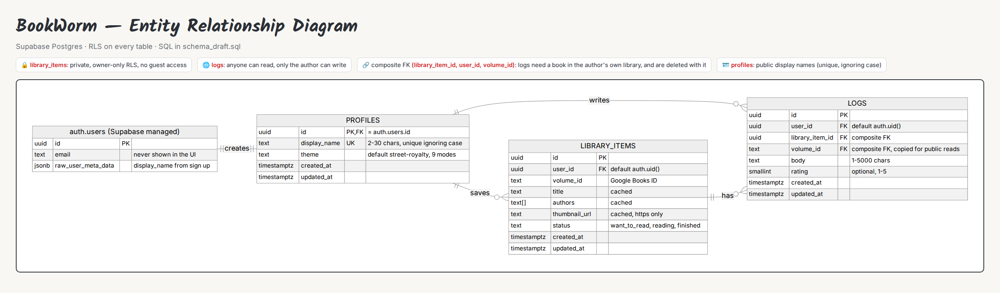
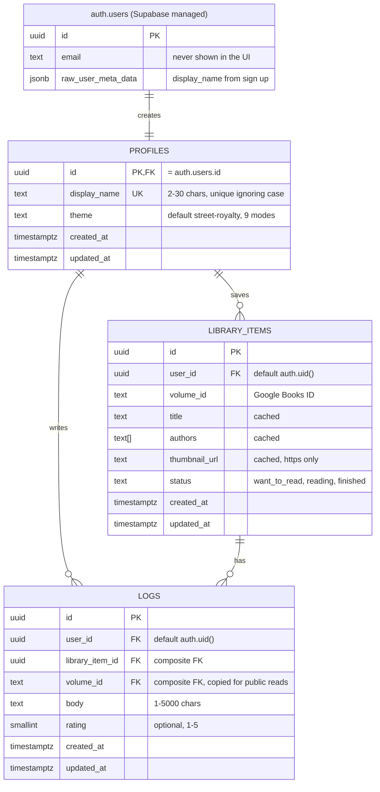

# BookWorm — Entity Relationship Diagram



The runnable SQL for this design is **[`schema_draft.sql`](schema_draft.sql)**: tables, constraints, triggers, RLS policies and grants. It was tested against PostgreSQL 16 with a stand-in for Supabase's `auth` schema (14 checks covering constraints, RLS and cascades). In the build phase it becomes the first Supabase migration, and PostgREST (`supabase-js`) serves the tables automatically.



## Relationships
| From | To | Type | Enforced by |
|---|---|---|---|
| `auth.users` | `profiles` | 1 : 1 | `profiles.id` PK + FK → `auth.users(id)` **ON DELETE CASCADE**. The `on_auth_user_created` trigger inserts the row at sign-up |
| `profiles` | `library_items` | 1 : many | `library_items.user_id` FK → `profiles(id)` ON DELETE CASCADE |
| `profiles` | `logs` | 1 : many | `logs.user_id` FK → `profiles(id)` ON DELETE CASCADE (this direct FK is what lets PostgREST embed `profiles(display_name)`) |
| `library_items` | `logs` | 1 : many | **Composite FK `(library_item_id, user_id, volume_id)` → `library_items(id, user_id, volume_id)` ON DELETE CASCADE** |

## Tables

### `profiles`: one per user, public display names
| Column | Type | Null | Default | Notes |
|---|---|---|---|---|
| `id` | uuid | no | — | PK, FK → `auth.users(id)` on delete cascade |
| `display_name` | text | no | — | Trimmed, 2–30 chars. **Unique index on `lower(display_name)`** |
| `theme` | text | no | `'street-royalty'` | Check: one of the 9 style-mode keys in `style_guide.md` |
| `created_at` | timestamptz | no | `now()` | |
| `updated_at` | timestamptz | no | `now()` | Kept current by `set_updated_at()` |

### `library_items`: a reader's saved books (**private**)
| Column | Type | Null | Default | Notes |
|---|---|---|---|---|
| `id` | uuid | no | `gen_random_uuid()` | PK |
| `user_id` | uuid | no | `auth.uid()` | FK → `profiles(id)` on delete cascade |
| `volume_id` | text | no | — | Google Books volume ID (1–64 chars) |
| `title` | text | no | — | Cached so My Library needs no Google calls |
| `authors` | text[] | no | `'{}'` | Cached |
| `thumbnail_url` | text | yes | — | Cached, must start with `https://` |
| `status` | text | no | `'want_to_read'` | Check: `want_to_read` · `reading` · `finished` |
| `created_at` / `updated_at` | timestamptz | no | `now()` | |

- `UNIQUE (user_id, volume_id)`: a reader can't save the same book twice.
- `UNIQUE (id, user_id, volume_id)`: the target for the logs composite FK.

### `logs`: what readers wrote (**public to read**)
| Column | Type | Null | Default | Notes |
|---|---|---|---|---|
| `id` | uuid | no | `gen_random_uuid()` | PK |
| `user_id` | uuid | no | `auth.uid()` | FK → `profiles(id)` on delete cascade |
| `library_item_id` | uuid | no | — | Part of the composite FK |
| `volume_id` | text | no | — | Part of the composite FK. Copied from the library item |
| `body` | text | no | — | 1–5000 chars after trimming |
| `rating` | smallint | yes | — | Check 1–5 (optional) |
| `created_at` / `updated_at` | timestamptz | no | `now()` | |

- Index `(volume_id, created_at desc)`: the book page query.
- Index `(library_item_id)`: fast cascade deletes.
- **Many logs per book** are allowed. There is no unique constraint on `(user_id, volume_id)`.

## Row Level Security (enabled on all three tables)
| Table | `anon` (guest) | `authenticated` (reader) |
|---|---|---|
| `profiles` | SELECT all | SELECT all · UPDATE own row (`display_name`, `theme` only) |
| `library_items` | **no access at all** (privileges revoked) | SELECT / INSERT / UPDATE (`status` only) / DELETE **own rows only** |
| `logs` | SELECT all | SELECT all · INSERT / UPDATE (`body`, `rating` only) / DELETE **own rows only** |

- Every policy compares against `(select auth.uid())`. Wrapping it in a select lets Postgres evaluate it once per query instead of once per row.
- Column-level UPDATE grants mean a reader can't move a log to another book or change a saved book's `volume_id`.
- No one can INSERT or DELETE profiles directly. The sign-up trigger creates them and deleting the auth user removes them.

## How this solves the privacy problem
> *Libraries are private, but logs must be publicly readable on a book's page.*

1. **The book page never reads `library_items`.** Each log carries its own `volume_id`, so the page asks only for logs and display names:
   ```js
   supabase.from('logs')
     .select('id, body, rating, created_at, user_id, profiles(display_name)')
     .eq('volume_id', id)
     .order('created_at', { ascending: false })
   ```
2. **`library_items` is locked to its owner** by RLS and by revoking every guest privilege, so no query can list someone else's library.
3. **The database itself guarantees a log belongs to a book in its author's library.** The composite FK `(library_item_id, user_id, volume_id)` must match a real row in `library_items`, so:
   - a log can't point at **someone else's** library item, because `user_id` must match, and RLS forces `user_id = auth.uid()`.
   - a log's copied `volume_id` can't **disagree** with the book it belongs to.
   - **removing the book deletes its logs** (`ON DELETE CASCADE`).
4. **Known trade-off:** a public log reveals that its author has *that one book* in their library. That's inherent to public logs. Nothing else about the library (other books, statuses, dates) is exposed.

## Other queries the app will use
| Page | Query |
|---|---|
| Book Details: "is it in my library?" | `from('library_items').select('id, status').eq('volume_id', id).maybeSingle()` (RLS returns only your row) |
| Book Details: add | `from('library_items').insert({ volume_id, title, authors, thumbnail_url })` (`user_id` defaults to `auth.uid()`) |
| Book Details: write log | `from('logs').insert({ library_item_id, volume_id, body, rating })` |
| Book Details: remove (confirm count) | `from('logs').select('id', { count: 'exact', head: true }).eq('library_item_id', itemId)` |
| My Library | `from('library_items').select('*').order('created_at', { ascending: false })`, optional `.eq('status', tab)` |
| Change status | `from('library_items').update({ status }).eq('id', itemId)` |
| Sign Up: is the name free? | `from('profiles').select('id').ilike('display_name', name).maybeSingle()` (escape `%` and `_` first). If the sign-up still fails, show "That display name is taken." |
| Style mode (reader) | `from('profiles').update({ theme }).eq('id', user.id)` |
