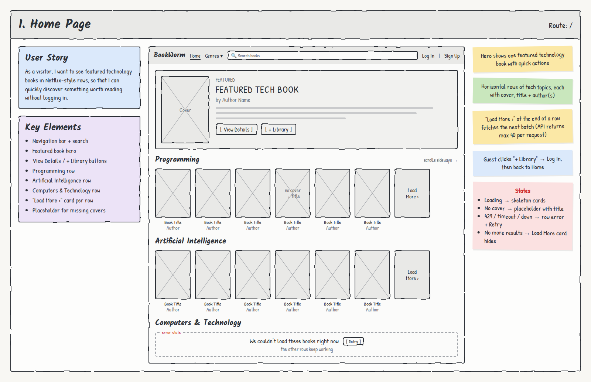

# 1. Home Page

**Route:** `/` · **Access:** Public (guests and readers)

## User story
As a **visitor**, I want to see featured technology books in Netflix-style rows, so that I can quickly discover something worth reading without logging in.

## Acceptance criteria
- [ ] The page loads without logging in.
- [ ] A **featured hero** shows one technology book: cover, title, author(s), short description, **View Details** and **+ Library** buttons.
- [ ] At least three side-scrolling rows of technology books: **Programming**, **Artificial Intelligence**, **Computers & Technology**.
- [ ] Every book card shows a **cover, title, and author(s)**. Clicking a card opens `/books/:id`.
- [ ] Each row ends with a **"Load More ›"** card that adds the next batch to that row. It disappears when there are no more results.
- [ ] Books without a cover show a placeholder cover with the title.
- [ ] Guest clicks **+ Library** → sent to `/login`, then returned to `/`.

## Key elements
- Navigation bar + search
- Featured book hero
- View Details / + Library buttons
- Programming, Artificial Intelligence, and Computers & Technology rows
- "Load More ›" card per row
- Placeholder for missing covers

## States & errors
| State | What the user sees |
|---|---|
| Loading | Skeleton cards in each row (layout doesn't jump) |
| Missing cover | Placeholder cover with the book title |
| Google 429 / timeout / down | That row shows "We couldn't load these books right now." + **Retry**. Other rows keep working |
| No more results | The "Load More ›" card hides |

## Data & permissions
- Books come from the **Google Books Edge Function** (never Google directly). Each row is a technology query, paged with a start index. The API returns at most 40 per request.
- No database tables are needed unless a reader clicks **+ Library**, which inserts into `library_items` (their own row only, enforced by RLS).

## Links
- **To:** Book Details (`/books/:id`), Search Results (via nav search), Genre (via Genres ▾), Log In / Sign Up
- **From:** Logo/Home link on every page, 404 "Go Home", Log Out
