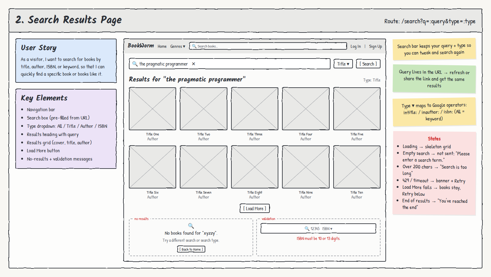

# 2. Search Results Page

**Route:** `/search?q=:query&type=:type` · **Access:** Public

## User story
As a **visitor**, I want to search for books by title, author, ISBN, or keyword, so that I can quickly find a specific book or books like it.

## Acceptance criteria
- [ ] The search box is **pre-filled** from the URL (`q`) and the dropdown from `type`.
- [ ] The type dropdown offers **All / Title / Author / ISBN**. All = keyword search.
- [ ] Heading shows **Results for "query"**.
- [ ] Results show in a grid. Each card has a **cover, title, and author(s)** and links to `/books/:id`.
- [ ] A **Load More** button adds the next page of results below the current ones and keeps the scroll position.
- [ ] Refreshing or sharing the URL shows the same results.
- [ ] An empty search is never sent.

## Key elements
- Navigation bar
- Search box (pre-filled from URL) + clear ✕
- Type dropdown: All / Title / Author / ISBN
- Results heading with query
- Results grid
- Load More button
- No-results and validation messages

## States & errors
| State | What the user sees |
|---|---|
| Loading | Skeleton grid |
| Empty search | Not submitted: "Please enter a search term." |
| Query over 200 characters | "Search is too long (max 200 characters)." |
| ISBN type, not 10 or 13 digits | "ISBN must be 10 or 13 digits." Not submitted |
| No matches | 🔍 "No books found for 'xyz'. Try a different search or search type." + **Back to Home** |
| Google 429 / timeout / error | Friendly banner + **Retry** |
| Load More fails | Books already shown stay. Error + **Retry** appears below them |
| End of results | Load More hides → "You've reached the end" |

## Data & permissions
- Calls the **Google Books Edge Function** with `q`, `type`, and page. The function validates input (missing, too long, page out of range) and maps type to Google operators: `intitle:`, `inauthor:`, `isbn:`.
- No database tables used.

## Links
- **To:** Book Details (`/books/:id`), Home
- **From:** Search bar in the nav on every page
