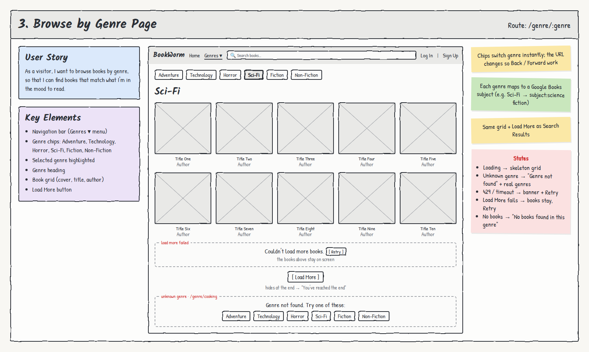

# 3. Browse by Genre Page

**Route:** `/genre/:genre` · **Access:** Public

## User story
As a **visitor**, I want to browse books by genre, so that I can find books that match what I'm in the mood to read.

## Acceptance criteria
- [ ] Genre chips for the six required genres: **Adventure, Technology, Horror, Sci-Fi, Fiction, Non-Fiction**.
- [ ] The current genre's chip is **highlighted**, and the genre name is the page heading.
- [ ] Clicking a chip changes the URL (e.g. `/genre/horror`), so browser Back/Forward work.
- [ ] Books show in a grid with **cover, title, and author(s)**. Each links to `/books/:id`.
- [ ] A **Load More** button appends the next page of results.
- [ ] The page works on direct visit or refresh.

## Key elements
- Navigation bar (Genres ▾ menu)
- Genre chips with the selected one highlighted
- Genre heading
- Book grid
- Load More button

## States & errors
| State | What the user sees |
|---|---|
| Loading | Skeleton grid |
| Unknown genre (e.g. `/genre/cooking`) | "Genre not found. Try one of these:" + the six genre chips |
| No books | "No books found in this genre." |
| Google 429 / timeout / error | Friendly banner + **Retry** |
| Load More fails | "Couldn't load more books." + **Retry**. Books above stay on screen |
| End of results | Load More hides → "You've reached the end" |

## Data & permissions
- Calls the **Google Books Edge Function** with a genre key. The function maps each genre to a Google Books `subject:` query (e.g. Sci-Fi → `subject:science fiction`, Non-Fiction → `subject:nonfiction`) and rejects unknown genres.
- No database tables used.

## Links
- **To:** Book Details (`/books/:id`), other genres
- **From:** Genres ▾ in the nav on every page
