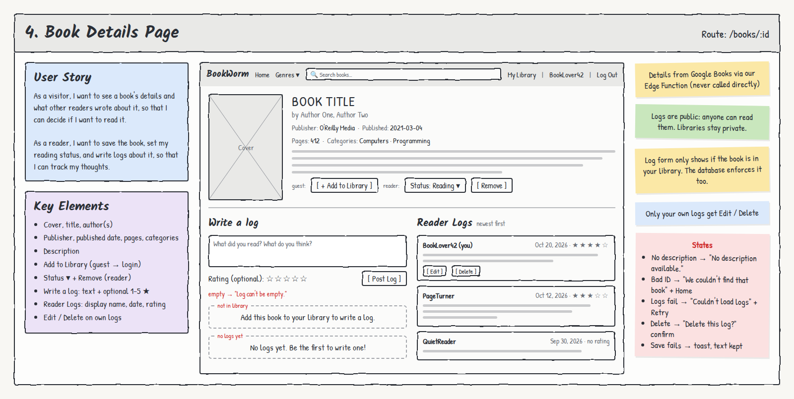

# 4. Book Details Page

**Route:** `/books/:id` · **Access:** Public to view. Library and log actions need login.

## User stories
- As a **visitor**, I want to see a book's details and what other readers wrote about it, so that I can decide if I want to read it.
- As a **reader**, I want to save the book, set my reading status, and write logs about it, so that I can track my thoughts.

## Acceptance criteria
- [ ] Shows **cover, title, author(s), description**, plus **publisher, published date, page count, categories**.
- [ ] Works when visited directly by URL or refreshed.
- [ ] **Guest:** sees **+ Add to Library**. Clicking it → `/login`, then back to this page.
- [ ] **Reader, book not saved:** **+ Add to Library** saves it with status *Want to Read*.
- [ ] **Reader, book saved:** sees a **Status ▾** (Want to Read / Reading / Finished) and **Remove**.
- [ ] **Write a log** form (text + optional 1–5 ★) appears **only if the book is in the reader's library**.
- [ ] **Reader Logs** lists every user's logs for this book, newest first, each with **display name** (never email), date, and rating.
- [ ] Only the reader's **own** logs show **Edit** and **Delete**. Edit is inline with Save/Cancel.
- [ ] Removing the book deletes the reader's logs for it, after a confirm.

## Key elements
- Cover, title, author(s)
- Publisher, published date, pages, categories
- Description
- Add to Library (guest → login)
- Status ▾ + Remove (reader)
- Write a log: text + optional 1–5 ★
- Reader Logs: display name, date, rating
- Edit / Delete on own logs

## States & errors
| State | What the user sees |
|---|---|
| Loading | Skeleton for details and logs |
| No description | "No description available." |
| No cover | Placeholder cover |
| Invalid / unknown ID | "We couldn't find that book." + **Go Home** |
| No logs yet | "No logs yet. Be the first to write one!" |
| Logs fail to load | Book details still show. Logs section: "Couldn't load logs." + **Retry** |
| Book not in library | No form: "Add this book to your library to write a log." |
| Empty log text | "Log can't be empty." Not submitted |
| Delete log | Confirm "Delete this log?" |
| Save / add fails | Toast "Couldn't save your log. Please try again." Typed text is kept |
| Already in library | Shows Status ▾ instead of Add. No duplicate (unique constraint) |

## Data & permissions
- **Book info:** Google Books Edge Function (by volume ID).
- **Logs:** `logs` filtered by `volume_id`, joined to `profiles` for `display_name`. **Anyone can SELECT logs.** Only the author can INSERT/UPDATE/DELETE their own.
- **Library check:** the reader's own `library_items` row for this `volume_id` (RLS: own rows only). The book page **never** reads other users' libraries.
- **Database guard:** a log's `(library_item_id, user_id)` must match the author's own library item (composite FK, `ON DELETE CASCADE`).

## Links
- **To:** Log In (guest action), My Library
- **From:** Any book card (Home, Search, Genre), My Library
