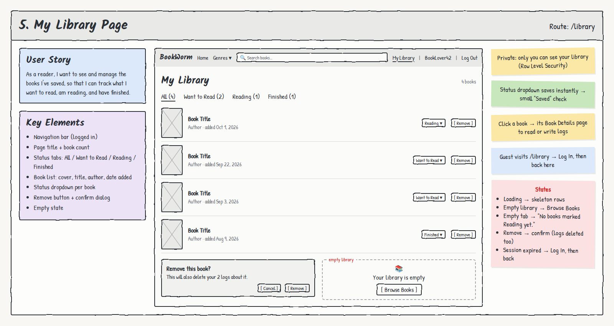

# 5. My Library Page

**Route:** `/library` · **Access:** Logged-in readers only

## User story
As a **reader**, I want to see and manage the books I've saved, so that I can track what I want to read, am reading, and have finished.

## Acceptance criteria
- [ ] Guests visiting `/library` are sent to `/login`, then returned here.
- [ ] Shows **only the logged-in reader's** saved books, never anyone else's.
- [ ] Status tabs **All / Want to Read / Reading / Finished** filter the list, with counts.
- [ ] Each row shows **cover, title, author(s), date added**, a **Status ▾**, and **Remove**.
- [ ] Changing the status **saves immediately** and shows a small "Saved" confirmation.
- [ ] **Remove** asks to confirm ("This will also delete your N logs about it") and then removes the book and its logs.
- [ ] Clicking a book opens its Book Details page.
- [ ] Data survives a refresh.

## Key elements
- Navigation bar (logged in: My Library, display name, Log Out)
- Page title + book count
- Status tabs
- Book list rows
- Status dropdown per book
- Remove button + confirm dialog
- Empty state

## States & errors
| State | What the user sees |
|---|---|
| Loading | Skeleton rows |
| Empty library | 📚 "Your library is empty" + **Browse Books** |
| Empty tab | "No books marked *Reading* yet." |
| Status change fails | Toast "Couldn't save your changes. Please try again." Dropdown reverts |
| Remove | Confirm dialog with the log count |
| Session expired | "Your session expired. Please log in again." → Log In, then back |

## Data & permissions
- Reads and writes `library_items`. **RLS: SELECT/INSERT/UPDATE/DELETE only where `user_id = auth.uid()`.** The library is fully private.
- Title, authors, and thumbnail are stored on the row, so this page needs **no Google Books calls**.
- Deleting a library item **cascades** to its logs in the database.

## Links
- **To:** Book Details (`/books/:id`), Home (Browse Books)
- **From:** "My Library" in the nav, redirect after login
