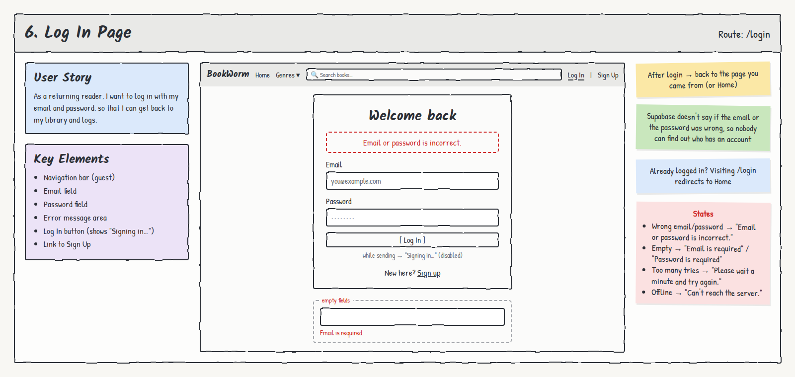

# 6. Log In Page

**Route:** `/login` · **Access:** Guests only (logged-in users are redirected Home)

## User story
As a **returning reader**, I want to log in with my email and password, so that I can get back to my library and logs.

## Acceptance criteria
- [ ] Email and password fields with labels.
- [ ] Empty fields are caught **before** submitting.
- [ ] While submitting, the button reads **"Signing in…"** and is disabled (no double submits).
- [ ] On success, the reader returns to the page they came from (e.g. a Book Details page), or Home.
- [ ] After login, the nav shows **My Library**, their display name, and **Log Out**.
- [ ] A **"New here? Sign up"** link goes to `/signup`.

## Key elements
- Navigation bar (guest)
- Email field
- Password field
- Error message area
- Log In button
- Link to Sign Up

## States & errors
| State | What the user sees |
|---|---|
| Wrong email **or** password | "Email or password is incorrect." Supabase intentionally doesn't say which one, so the form can't reveal who has an account |
| Empty field | Inline "Email is required." / "Password is required." |
| Bad email format | "Enter a valid email address." |
| Too many attempts | "Too many attempts. Please wait a minute and try again." |
| Offline / server unreachable | "Can't reach the server. Check your connection and try again." |
| Already logged in | Redirect to Home |

## Data & permissions
- `supabase.auth.signInWithPassword({ email, password })` (Supabase Auth).
- No tables written. The display name for the nav is read from the reader's `profiles` row.

## Links
- **To:** Sign Up, the page they came from, Home
- **From:** "Log In" in the nav, any guest action that needs login (Add to Library, `/library`)
