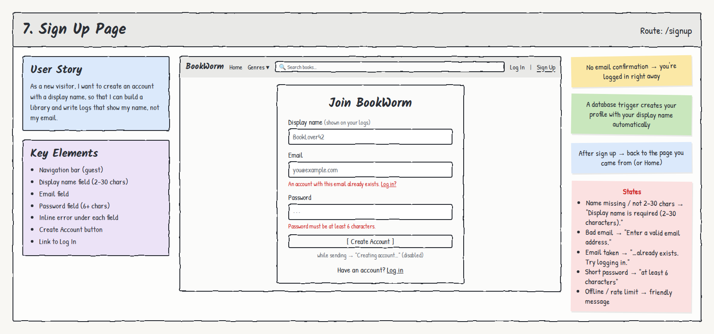

# 7. Sign Up Page

**Route:** `/signup` · **Access:** Guests only (logged-in users are redirected Home)

## User story
As a **new visitor**, I want to create an account with a display name, so that I can build a library and write logs that show my name, not my email.

## Acceptance criteria
- [ ] Fields: **Display name** (2–30 characters), **Email**, **Password** (6+ characters).
- [ ] Each field shows its own inline error. The form is validated before submitting.
- [ ] While submitting, the button reads **"Creating account…"** and is disabled.
- [ ] **No email confirmation:** the new user is logged in right away.
- [ ] A **profile** with the display name is created automatically.
- [ ] On success, the user returns to the page they came from, or Home.
- [ ] A **"Have an account? Log in"** link goes to `/login`.

## Key elements
- Navigation bar (guest)
- Display name field
- Email field
- Password field
- Inline error under each field
- Create Account button
- Link to Log In

## States & errors
| State | What the user sees |
|---|---|
| Display name missing / not 2–30 chars | "Display name is required (2–30 characters)." |
| Bad email format | "Enter a valid email address." |
| Email already registered | "An account with this email already exists. Try logging in." (with a link) |
| Display name already taken (any capitalization) | "That display name is taken. Try another one." |
| Password under 6 characters | "Password must be at least 6 characters." |
| Too many attempts | "Too many attempts. Please wait a minute and try again." |
| Offline | "Can't reach the server. Check your connection and try again." |

## Data & permissions
- `supabase.auth.signUp({ email, password, options: { data: { display_name } } })`.
- A **database trigger** on `auth.users` inserts the `profiles` row using `display_name` from the sign-up metadata.
- `profiles` RLS: anyone can read display names. Users can update only their own.
- "Confirm email" is turned **off** in Supabase Auth settings.

## Links
- **To:** Log In, the page they came from, Home
- **From:** "Sign Up" in the nav, "New here? Sign up" on Log In
