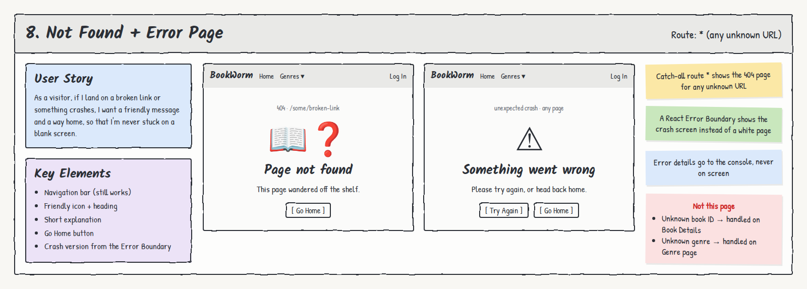

# 8. Not Found + Error Page

**Route:** `*` (any unknown URL), plus the app-wide crash screen · **Access:** Public

## User story
As a **visitor**, if I land on a broken link or something crashes, I want a friendly message and a way home, so that I'm never stuck on a blank screen.

## Acceptance criteria
- [ ] Any unknown URL (e.g. `/some/broken-link`) shows the **404** page: "Page not found" + **Go Home**.
- [ ] Unknown URLs also work on direct visit and refresh on Vercel (`vercel.json` rewrites everything to `index.html`, and React Router shows the 404).
- [ ] A **React Error Boundary** around the routes shows **"Something went wrong"** with **Try Again** and **Go Home** instead of a white screen.
- [ ] The navigation bar still works on both screens.
- [ ] Technical error details go to the console, never on screen.

## Key elements
- Navigation bar
- Friendly icon + heading
- Short explanation
- Go Home button (+ Try Again on the crash screen)

## Not handled here
- Unknown **book ID** → handled on Book Details ("We couldn't find that book").
- Unknown **genre** → handled on the Genre page ("Genre not found").

## Data & permissions
- None. Purely front-end.

## Links
- **To:** Home
- **From:** Any broken link or unexpected error
