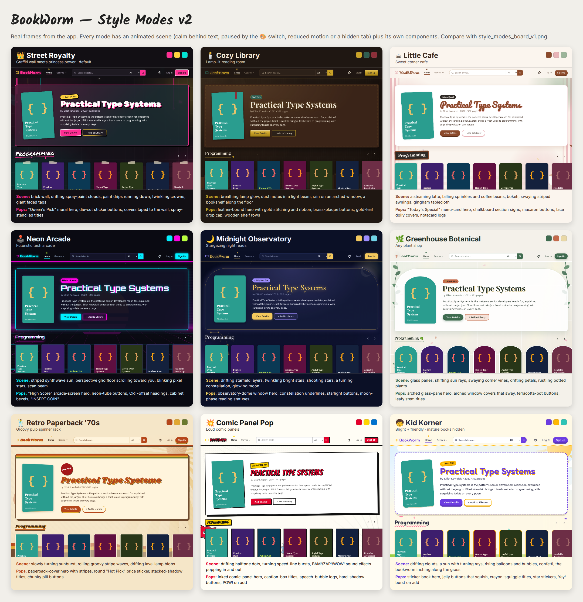

# Style Guide — BookWorm

> **v2 (current):** every mode now has an **animated background scene** and bolder, mode-specific components. The original palette board is kept for comparison as [`style_modes_board_v1.png`](style_modes_board_v1.png).

## Visual identity
- **Vibe:** *Netflix for books, with personality.* Immersive, cover-first browsing in a dark-or-light "room" the reader picks. Every mode is a different place to browse: a graffiti wall, a lamp-lit library, a corner cafe, an arcade, and more.
- **Design inspiration:** Netflix's oversized featured artwork, horizontal rows, and bold hierarchy, but BookWorm has its own identity and never copies Netflix branding.
- **Primary goal:** **Let the book covers stand out.** The interface supports discovery and reading logs without overwhelming the page. Decorations live at the edges (headers, empty states, badges) and never behind body text.
- **Style modes:** BookWorm ships **9 style modes**. Each one changes colors, fonts, an **animated background scene**, and how components look (hero panel, buttons, section titles, covers, logs, hover effects). **Layout, components, and behavior never change between modes.**
- **Lively at the edges, calm behind text:** scenes are strongest at the page edges and around the hero. Reading areas sit in a calm zone or on near-solid reading panels.

---

## Layout (shared by every mode)
- **Responsive:** mobile-first, with breakpoints at **480 / 768 / 1024 / 1280px**. Max content width 1280px, 16px side gutters on mobile, 32px on desktop.
- **Spacing scale:** 4 · 8 · 12 · 16 · 24 · 32 · 48 · 64. Use it everywhere. No one-off margins.
- **Home (`/`):** featured book hero → horizontal rows (Programming, Artificial Intelligence, Computers & Technology), each ending in a "Load More ›" card. Rows scroll sideways (scroll-snap) and are swipeable on touch.
- **Search Results / Genre:** page heading + controls (search box + type, or genre chips) → responsive grid (2 cols mobile, 3 tablet, 5–6 desktop) → Load More.
- **Book Details:** cover + info side by side on desktop, stacked on mobile. Below: "Write a log" + "Reader Logs" in two columns on desktop, one column on mobile.
- **My Library:** heading + status tabs → list rows (cover thumb, title/author/date, status dropdown, remove). On mobile, the controls wrap under the title.
- **Auth pages:** a single centered card, max 420px wide.
- Avoid cramped layouts. Keep at least 24px between rows and 12px between cards.

---

## How style modes work (for the builder)
1. **Tokens, not hex.** Each mode is one CSS file in `src/styles/themes/<mode>.css` that sets the **same variables** on `[data-theme="<mode>"]`. Components only ever use `var(--…)`.

   | Token | Used for |
   |---|---|
   | `--bg` | Page background |
   | `--surface` | Cards, panels, nav, inputs |
   | `--surface-hover` | Hovered card / row |
   | `--text` | Primary text |
   | `--text-muted` | Authors, dates, metadata |
   | `--accent` | Primary buttons, active states, focus ring, links |
   | `--on-accent` | Text/icons on `--accent` |
   | `--accent-2`, `--accent-3` | Badges, chips, decorations (with `--on-accent-2/3` for text on them) |
   | `--border` | Inputs, dividers, secondary buttons |
   | `--error`, `--success` | Messages and toasts |
   | `--font-display` | Logo, hero title, section titles only |
   | `--font-heading` | h1–h3 |
   | `--font-body` | Everything else |
   | `--radius`, `--radius-card` | Corner rounding |
   | `--card-shadow`, `--card-hover-shadow` | Card depth |
   | `--texture` | Static page texture. Set to `none` once a mode has its animated scene |
   | `--veil-color`, `--veil-color-mobile` | Calm-zone wash over the central reading column (stronger on mobile) |
   | `--reading-panel`, `--reading-panel-pad` | Near-solid panel behind book info and descriptions in scene modes |
   | `--card-hover-transform`, `--hover-ease`, `--t-hover` | Each mode's own card hover move and feel |
   | `--base-size` | Root font size (16px, Kid Korner 18px) |

2. **Applying a mode:** set `document.documentElement.dataset.theme = "street-royalty"`.
3. **`ThemeProvider` + `useTheme()`** (React context) owns the current mode. **Load order:** the logged-in reader's `profiles.theme` → `localStorage["bookworm-theme"]` → default **`street-royalty`**. Changing mode updates the `data-theme` attribute and localStorage, and (if logged in) `profiles.theme`.
4. **Decorations:** each mode may add one small `src/styles/themes/<mode>.decor.css` for signature touches (drips, scanlines, shelf lines, stars). Decorations are pure CSS (pseudo-elements or background images) and marked decorative. **No mode gets its own components.**
5. **Fonts:** load only the active mode's Google Fonts, by injecting its `<link>` when the mode changes. Always provide a system fallback (`system-ui, sans-serif` or `Georgia, serif`).
6. **Mode picker:** a 🎨 palette button in the nav (`aria-label="Change style mode"`) opens a popover grid of 9 preview tiles. Each tile shows the mode's bg, accent swatch and name. The current tile shows **"✓ Current"** in text, not just a color. Arrow keys move between tiles, Enter selects, and Esc closes.
7. **Animated scenes (v2):**
   - `src/components/ThemeBackdrop.jsx` is mounted once in `RootLayout`, behind `.app-shell`. It's fixed, `aria-hidden` and `pointer-events: none`.
   - It renders the current mode's scene from `src/theme/backdrops/<Mode>Scene.jsx`: layered divs and inline SVG, about 8–36 elements.
   - The scene's keyframes live in `src/styles/themes/<mode>.scene.css`, imported through `themes/index.css`.
   - **Rules:**
     - animate only `transform` and `opacity`
     - use long, varied durations with negative delays, so nothing moves in lockstep and a paused scene still looks lively
     - use custom easing
     - no flashing more than 3 times a second
   - **Performance budget:** about 55fps or more in headless Chromium. Avoid huge animated textures, `filter` on moving layers, and scaling big gradients. Add `will-change` only after measuring that it helps.
8. **Calm zone + reading panels:** the backdrop's last layer is a veil (`--veil-color`) over the central column. Book details and descriptions sit on `--reading-panel`. Text contrast must never depend on what's moving behind it.
9. **Motion control:** the 🎨 picker has a **"Background animation" switch** (`role="switch"`, saved as `localStorage["bookworm-motion"]`, which sets `<html data-motion>`). Scenes **pause** when:
   - the switch is off
   - the device asks for reduced motion
   - the tab is hidden (`<html data-hidden>`)
   Paused scenes freeze on a still frame instead of disappearing.
10. **Per-mode microcopy** lives in `src/theme/modes.js`: the hero badge label (`featured`), the "added" toast, and the reading-status icons.
11. **Kid Korner content filter:** while Kid Korner is active, every book request to the Edge Function includes **`kids=true`**. The function then adds Google's `maxAllowedMaturityRating=not-mature`. *Honest note:* Google's maturity data isn't perfect and a child can switch modes, so this is a gentle filter, **not** parental controls.

---

## The 9 style modes

Each palette below passed a WCAG AA contrast check:
- text and muted text on background and surface ≥ 4.5:1
- `--on-accent` on accent ≥ 4.5:1
- accent on background ≥ 3:1 (for focus rings and icons)
- error text ≥ 4.5:1

`--accent-2` / `--accent-3` are for **decoration and badges**. Put text on them only with the listed "on" color.

### 1. 👑 Street Royalty: *graffiti wall meets princess power* (DEFAULT)
**Vibe:** Queen energy on a spray-painted wall. Bold, loud, confident and glam, like a tagged brick alley where every reader wears a crown. Dark like Netflix, so covers glow.

| Purpose | Color | Hex |
|---|---|---|
| Background | Midnight alley | `#120F14` |
| Surface | Wet asphalt | `#1E1A22` |
| Surface hover | Shadow violet | `#2A2430` |
| Primary text | White | `#FFFFFF` |
| Muted text | Lilac gray | `#BDB3C7` |
| **Primary accent** | Hot pink spray | `#FF2E93` (text on it: `#120F14`) |
| Accent 2 | Crown gold | `#FFD23F` (text on it: `#120F14`) |
| Accent 3 | Spray teal | `#00E5D4` (text on it: `#120F14`) |
| Border | Brick shadow | `#3A3242` |
| Error | Coral red | `#FF6B6B` |
| Success | Mint tag | `#3DDC97` |

- **Fonts:** display **Rubik Spray Paint** (logo only) · hero and book page titles **Bungee** (block signage letters, readable under the stacked shadow) · headings **Permanent Marker** · body **Inter**.
- **Decorations:** a spray **drip** under section titles (pink, pure CSS) · a 👑 **crown** above the active nav link · hero badge **"Queen's Pick"** · genre chips as **sticker tags**, each tilted ±2° · faint concrete-noise texture on the background.
- **Cards:** radius 6px. Hover → lift 4px, pink glow (`0 0 0 2px #FF2E93, 0 8px 24px rgba(255,46,147,.35)`), tilt 1°.
- **Buttons:** primary hot pink with dark text and a slight marker-stroke underline. Secondary is transparent with a gold border.
- **Reading status:** Want to Read ✨ · Reading 🎨 · Finished 👑
- **Microcopy:** confident and hype. "Crowned! Added to your library." · "No books found. Remix your search."
- **Animated scene (v2):** A tagged brick wall. Pink, gold and teal **spray-paint clouds drift and bloom**, fresh **paint drips run down** from the top edge and a drop falls away, **crowns and sparkles twinkle**, and giant faded "QUEEN" / "READ" tags sit in the corners.
- **Components (v2):** Hero = a **"👑 Queen's Pick" mural** (pink outline, hard black shadow). **Die-cut sticker buttons** (white outline, offset shadow, tilted ±1.5°). **Covers taped to the wall** that peel on hover. Spray-stenciled titles with drips, and white headline type with a pink and black stacked shadow.

### 2. 🕯️ Cozy Library: *lamp-lit reading room*
**Vibe:** Leather armchair, brass lamp, walnut shelves, rain on the window. Warm, quiet and timeless.

| Purpose | Color | Hex |
|---|---|---|
| Background | Walnut | `#1F1712` |
| Surface | Dark oak | `#2C2119` |
| Surface hover | Worn leather | `#3A2C21` |
| Primary text | Parchment | `#F3E9D7` |
| Muted text | Old paper | `#BFAE95` |
| **Primary accent** | Brass | `#C9A227` (text on it: `#1F1712`) |
| Accent 2 | Library green | `#2F5D50` (text on it: `#FFFFFF`) |
| Accent 3 | Oxblood | `#8C2F39` (text on it: `#FFFFFF`) |
| Border | Shelf edge | `#4A3828` |
| Error | Rose clay | `#EF8A80` |
| Success | Fern | `#9CCC65` |

- **Fonts:** display/headings **Playfair Display** · body **Lora**.
- **Decorations:** subtle wood-grain texture · each book row sits on a **shelf line** (4px oak bar with a shadow) · a warm **lamp vignette** glow at the top of the page · an oxblood **ribbon bookmark** on saved books.
- **Cards:** radius 2px, like book spines, with a soft inner shadow. Hover → the book **tilts out from the shelf** (rotate −3°, lift).
- **Buttons:** brass with a dark engraved label. Secondary has a thin brass outline.
- **Reading status:** Want to Read 🔖 · Reading 📖 · Finished 📚
- **Microcopy:** gentle. "Shelved." · "The shelves are quiet. No logs yet."
- **Animated scene (v2):** Walnut wall panels. The **reading lamp's glow breathes**, **dust motes float** through a beam of lamplight, **rain runs down an arched window**, and a bookshelf lines the bottom of the room.
- **Components (v2):** Hero = a **leather-bound volume** with gold stitching and an oxblood ribbon bookmark ("Staff Pick"). **Bevelled brass-plaque buttons**. Double brass rule + ❦ under titles. A **gold-leaf drop cap** on "About this book". Book rows stand on a wooden shelf and covers tilt out.

### 3. ☕ Little Cafe: *sweet corner cafe*
**Vibe:** Latte foam, strawberry milk and matcha, a chalkboard menu and a croissant on the side. Light, sweet and inviting.

| Purpose | Color | Hex |
|---|---|---|
| Background | Cream foam | `#FBF5EE` |
| Surface | Porcelain | `#FFFFFF` |
| Surface hover | Latte | `#F3E6D8` |
| Primary text | Espresso | `#3B2A20` |
| Muted text | Mocha | `#7A6355` |
| **Primary accent** | Cinnamon | `#8B4A2B` (text on it: `#FFFFFF`) |
| Accent 2 | Strawberry milk | `#E8B4B8` (text on it: `#111111`) |
| Accent 3 | Matcha | `#9CB59A` (text on it: `#111111`) |
| Border | Napkin | `#E3D3C3` |
| Error | Cherry | `#B3261E` |
| Success | Basil | `#3E6B3C` |

- **Fonts:** display **Pacifico** (logo/hero only) · headings **Fraunces** · body **Nunito**.
- **Decorations:** section headers styled like a **chalkboard menu** sign (dark board, cream text) · genre chips as **menu tags** · logs as **notecards** with a faint ruled line · a CSS **steam curl** above the hero cover · a faint coffee-ring texture in empty states.
- **Cards:** radius 14px with soft shadows. Hover → warm lift with a latte-tinted surface.
- **Buttons:** cinnamon pill buttons. Secondary is a strawberry-milk outline.
- **Reading status:** Want to Read 🧁 · Reading ☕ · Finished 🍰
- **Microcopy:** sweet. "Added to your order! (library)" · "Nothing on the menu for that search."
- **Animated scene (v2):** A **latte steams** in the corner, **pastel sprinkles and coffee beans** drift down, soft bokeh floats, **candy-striped awnings sway** at the page edges, and a gingham tablecloth runs along the bottom.
- **Components (v2):** Hero = a **menu card** ("Today's Special" chalk pill). Section titles are **hanging chalkboard signs**. **Macaron buttons** that press down. Covers sit on a **lace doily** on hover, and logs are **lined notecards**.

### 4. 🕹️ Neon Arcade: *futuristic tech arcade*
**Vibe:** A synthwave arcade at 2am. CRT glow, neon tubes, a grid horizon. Perfect for the "technology" home page.

| Purpose | Color | Hex |
|---|---|---|
| Background | Void | `#0A0A12` |
| Surface | Cabinet | `#141428` |
| Surface hover | Screen glow | `#1F1F3A` |
| Primary text | Ice white | `#E8F7FF` |
| Muted text | Steel blue | `#8FA3BF` |
| **Primary accent** | Neon cyan | `#00F0FF` (text on it: `#0A0A12`) |
| Accent 2 | Hot magenta | `#FF00E5` (text on it: `#0A0A12`) |
| Accent 3 | Laser lime | `#B8FF3C` (text on it: `#0A0A12`) |
| Border | Circuit | `#2E2E5C` |
| Error | Alarm pink | `#FF4D6D` |
| Success | Laser lime | `#B8FF3C` |

- **Fonts:** labels/badges **Press Start 2P** (short labels only: it's wide) · headings **Orbitron** · body **Inter**.
- **Decorations:** a faint **CRT scanline** overlay (2px stripes, 4% opacity) · a magenta-to-cyan **perspective grid horizon** behind the hero · ratings as **pixel stars** · a 🪙 coin icon on Load More ("Load More ▸").
- **Cards:** radius 4px with a 1px circuit border. Hover → **neon glow** in cyan (`0 0 12px #00F0FF`).
- **Buttons:** cyan with dark text and a glow on hover. Secondary has a magenta outline.
- **Reading status:** Want to Read 🎯 · Reading 🎮 · Finished 🏆
- **Microcopy:** playful game talk. "Item acquired!" · "Game over: no results. Try again?"
- **Animated scene (v2):** A synthwave horizon. A **striped sun** rises and settles over a **perspective grid floor scrolling toward you**, pixel stars blink, a scan beam sweeps down, and the logo's neon tube **flickers gently** (2 dips every 9s).
- **Components (v2):** Hero = an **arcade screen** ("High Score" pixel badge). **Neon-tube buttons** with an inner glow. Headings with a **CRT chromatic offset**. Covers in **cabinet bezels**, and Load More reads **"INSERT COIN"**.

### 5. 🌙 Midnight Observatory: *stargazing night reads*
**Vibe:** Deep navy sky, telescope brass, constellations. Dreamy, calm and great for bedtime reading.

| Purpose | Color | Hex |
|---|---|---|
| Background | Night sky | `#0B1026` |
| Surface | Deep space | `#141B3A` |
| Surface hover | Nebula | `#1E2750` |
| Primary text | Moonlight | `#EEF1FF` |
| Muted text | Haze | `#A7B0D6` |
| **Primary accent** | Starlight gold | `#F4C95D` (text on it: `#0B1026`) |
| Accent 2 | Lavender nebula | `#9D8CFF` (text on it: `#111111`) |
| Accent 3 | Comet blue | `#6FD3E8` (text on it: `#111111`) |
| Border | Orbit | `#2A3566` |
| Error | Red giant | `#FF7A8A` |
| Success | Aurora | `#7FE0B5` |

- **Fonts:** display/headings **Cormorant Garamond** (600) · body **Nunito Sans**.
- **Decorations:** a sparse **starfield** background (CSS radial gradients) · thin gold **constellation lines** that link the rating stars · a crescent moon in the hero.
- **Cards:** radius 10px. Hover → a gentle **twinkle**, a soft gold glow that fades in.
- **Buttons:** starlight gold. Secondary has a lavender outline.
- **Reading status (moon phases):** Want to Read 🌑 · Reading 🌓 · Finished 🌕
- **Microcopy:** dreamy. "Added to your sky." · "No stars in this part of the sky. Try another search."
- **Animated scene (v2):** Two **starfield layers drift** at different speeds while the **brightest stars twinkle**, nebulae float, a **constellation slowly turns**, the **moon's glow breathes**, and **shooting stars** streak by now and then.
- **Components (v2):** Hero = an **arched window in the observatory dome** ("★ Brightest Star"). Constellation underlines (stars joined by a gold line). Starlight-glow buttons. Moon-phase reading statuses.

### 6. 🌿 Greenhouse Botanical: *airy plant shop*
**Vibe:** A glass greenhouse at noon, with ferns, terracotta pots and linen. Fresh, soft and calming.

| Purpose | Color | Hex |
|---|---|---|
| Background | Linen | `#F4F1EA` |
| Surface | White petal | `#FFFFFF` |
| Surface hover | Morning dew | `#E8EFE4` |
| Primary text | Deep moss | `#26332A` |
| Muted text | Sage stem | `#5F6F63` |
| **Primary accent** | Fern | `#3F6B4F` (text on it: `#FFFFFF`) |
| Accent 2 | Terracotta | `#C46A4A` (text on it: `#111111`) |
| Accent 3 | Pollen | `#E9D8A6` (text on it: `#111111`) |
| Border | Dried leaf | `#D3DBCD` |
| Error | Poppy | `#B3261E` |
| Success | Ivy | `#2F6B3F` |

- **Fonts:** display/headings **DM Serif Display** · body **Work Sans**.
- **Decorations:** cover images in **arched greenhouse-window frames** (rounded top corners) · leaf silhouettes in page corners · terracotta pot-shaped badges.
- **Cards:** arched top radius (`60px 60px 8px 8px` on the cover). Hover → a slight **sway** (rotate ±1°).
- **Buttons:** fern green. Secondary has a terracotta outline.
- **Reading status (growth):** Want to Read 🌱 seed · Reading 🌿 sprout · Finished 🌸 bloom
- **Microcopy:** nurturing. "Planted in your library." · "Nothing's growing here yet. Write the first log!"
- **Animated scene (v2):** Glass panes in a white frame with **sunbeams slowly shifting** through, **vines swaying** from the top corners, **petals drifting** down side to side, and **potted plants rustling** in the bottom corners.
- **Components (v2):** Hero = an **arched glass pane** ("🌱 Fresh Pick"). Covers in arched windows that **sway from their base**. The secondary button is a **terracotta pot rim**. Leafy stem + 🌿 on titles.

### 7. 🕺 Retro Paperback '70s: *groovy pulp spinner rack*
**Vibe:** A drugstore paperback spinner rack in 1974. Burnt orange, mustard, avocado and brown. Chunky, groovy and nostalgic.

| Purpose | Color | Hex |
|---|---|---|
| Background | Sand | `#F5E6C8` |
| Surface | Cream page | `#FFF4DC` |
| Surface hover | Toast | `#F0D9AE` |
| Primary text | Chocolate | `#3D2314` |
| Muted text | Walnut | `#6E4A2F` |
| **Primary accent** | Burnt orange | `#B5461A` (text on it: `#FFFFFF`) |
| Accent 2 | Mustard | `#E1A730` (text on it: `#111111`) |
| Accent 3 | Avocado | `#6B7A2E` (text on it: `#FFFFFF`) |
| Border | Kraft | `#D9BC8A` |
| Error | Brick | `#A4161A` |
| Success | Olive | `#4F6324` |

- **Fonts:** display/headings **Shrikhand** · body **Karla**.
- **Decorations:** **triple rainbow stripes** (orange / mustard / brown) on headers and the nav's bottom edge · a **"95¢" price-tag** sticker as the "new" badge · paper-grain texture · sunburst behind the hero.
- **Cards:** radius 8px with a cream page edge. Hover → a **spinner-rack tilt** (rotateY 6°).
- **Buttons:** pill-shaped burnt orange. Secondary has a mustard outline.
- **Reading status:** Want to Read 🌼 · Reading 📻 · Finished 🌈
- **Microcopy:** groovy. "Far out! Added to your library." · "Bummer, no books found."
- **Animated scene (v2):** A **sunburst slowly turns** in the corner, **groovy stripe waves roll** along the bottom (orange, mustard, brown), and **lava-lamp blobs** drift up and down.
- **Components (v2):** Hero = a **1970s paperback cover** (stripe band, brown outline, hard shadow) with a round red **"Hot Pick" price sticker**. Headings with a **stacked orange/brown drop shadow**. Chunky pill buttons with a stripe stack. Spinner-rack covers.

### 8. 💥 Comic Panel Pop: *loud, playful comic panels*
**Vibe:** A fresh comic page with ink outlines, halftone dots, speech bubbles and CMYK primaries. Energetic, with manga/comic energy.

| Purpose | Color | Hex |
|---|---|---|
| Background | Newsprint | `#FFFDF5` |
| Surface | Panel white | `#FFFFFF` |
| Surface hover | Highlight yellow | `#FFF3B0` |
| Primary text | Ink | `#111111` |
| Muted text | Pencil | `#4A4A4A` |
| **Primary accent** | Hero red | `#E4002B` (text on it: `#FFFFFF`) |
| Accent 2 | Zap yellow | `#FFD400` (text on it: `#111111`) |
| Accent 3 | Cape blue | `#0072CE` (text on it: `#FFFFFF`) |
| Border | Ink | `#111111` |
| Error | Villain red | `#C8102E` |
| Success | Go green | `#00853E` |

- **Fonts:** display/headings **Bangers** · body **Comic Neue** (the readable comic font, not Comic Sans).
- **Decorations:** **3px ink borders** on everything · a **halftone dot** texture in the hero and empty states · logs as **speech bubbles** (with a tail) · section titles in yellow caption boxes · a **"POW!" burst** on Add to Library (only when motion is allowed).
- **Cards:** radius 0, with a hard offset shadow `4px 4px 0 #111`. Hover → the shadow grows to `8px 8px 0` and the card moves up-left (it "pops").
- **Buttons:** red with white Bangers text and a hard shadow. Secondary is white with an ink border.
- **Reading status:** Want to Read 💭 · Reading 💬 · Finished 💥
- **Microcopy:** comic sound effects. "KA-CHUNK! Added!" · "Whoops! No books found."
- **Animated scene (v2):** **Halftone dots drift**, **speed-line bursts slowly turn** in two corners, and sound effects (**BAM! ZAP! WOW! POW! ZOOM!**) pop in, hold and fade at the edges.
- **Components (v2):** Hero = an **inked comic panel** ("Hero of the Day" caption). **Caption-box titles**. Ink outlines and hard shadows on panels and buttons. **Speech-bubble logs**. A **POW!** burst when a book is added.

### 9. 🧒 Kid Korner: *bright and friendly for school-age readers*
**Vibe:** A sunny classroom reading nook with stickers, rounded shapes and a friendly bookworm mascot. Big, clear and encouraging. **Mature books are filtered out while this mode is on.**

| Purpose | Color | Hex |
|---|---|---|
| Background | Sunny paper | `#FFF9E6` |
| Surface | White | `#FFFFFF` |
| Surface hover | Sky | `#E6F7FF` |
| Primary text | Navy ink | `#2B2D42` |
| Muted text | Slate | `#5C5F7A` |
| **Primary accent** | Grape | `#6C3CE1` (text on it: `#FFFFFF`) |
| Accent 2 | Sunshine | `#FFB703` (text on it: `#111111`) |
| Accent 3 | Teal splash | `#2EC4B6` (text on it: `#111111`) |
| Accent 4 | Bubblegum | `#FF6B9A` (decoration only) |
| Border | Crayon box | `#E4DCC2` |
| Error | Apple red | `#C1121F` |
| Success | Pine | `#1F7A70` |

- **Fonts:** display/headings **Fredoka** · body **Lexend** (designed for reading ease). Base size **18px**.
- **Decorations:** a **waving bookworm mascot** 🐛 in empty states and the hero · crayon-scribble underlines on headings · a **gold-star sticker** on Finished books · confetti dots in the background.
- **Cards:** radius 20px with chunky 3px colored borders. Hover → a bouncy lift (`scale(1.03)`).
- **Buttons:** big grape buttons, **48px minimum height**. Secondary has a sunshine outline.
- **Reading status:** Want to Read ⭐ · Reading 🐛 · Finished 🏅
- **Microcopy:** simple and encouraging, short sentences. "Yay! You saved this book!" · "Hmm, we couldn't find that. Try a different word!" Error messages never blame the reader.
- **Animated scene (v2):** **Puffy clouds drift**, a sun's **rays slowly turn**, **balloons and bubbles float up**, confetti falls, and the **bookworm mascot inches along the grass** at the bottom.
- **Components (v2):** Hero = a **sticker-book page** (dashed purple border, "⭐ Star Pick" sticker). **Jelly buttons** that squish when pressed. **Crayon-squiggle** titles. The 🐛 mascot in empty states. A **"⭐ Yay!"** burst when a book is saved.

---

## Typography (shared scale)
| Role | Size (desktop / mobile) | Font token | Notes |
|---|---|---|---|
| Display (logo, hero title) | 56 / 36px | `--font-display` | Only for short text, never paragraphs |
| H1 (page title) | 36 / 28px | `--font-heading` | One per page |
| H2 (section / row title) | 28 / 22px | `--font-display` or `--font-heading` | |
| H3 (card group, log author) | 20 / 18px | `--font-heading` | |
| Body | 16px (Kid Korner 18px) | `--font-body` | Line height 1.55, max 70 characters per line |
| Small / metadata | 14px | `--font-body` | `--text-muted`: authors, dates, page counts |
- Book titles on cards: 15px, `--font-body`, semibold, clamped to 2 lines.
- Never put decorative fonts (Rubik Spray Paint, Pacifico, Press Start 2P, Bangers, Shrikhand) on body text, form labels or error messages.

## Book cards
- Cover is **2:3 portrait** with `object-fit: cover`. Same proportions everywhere.
- Below the cover: **title** (2 lines max) and **author(s)** (1 line, muted).
- The **whole card is one link** to `/books/:id`, with `aria-label="Book Title by Author"`.
- **Missing cover:** a per-mode placeholder (a `--surface` block with the title in `--font-heading` and a small mode icon). Never a broken image.
- **Hover / focus:** the mode's hover effect. Focus also gets a 3px `--accent` outline with a 2px offset.
- Corner rounding comes from `--radius-card`, so each mode controls it.
- **In-library badge:** a small check badge on the cover corner ("✓ Saved"), with text, not color alone.

## Buttons and interactions
- **Primary:** `--accent` background, `--on-accent` text. Used for Add to Library, Post Log, Log In, Create Account.
- **Secondary:** transparent with a 2px `--border` (or the mode's outline color). Used for Remove, Cancel, View Details.
- **Danger confirm:** `--error` text with an outline. Used in the remove-book and delete-log dialogs.
- **Library state:** "+ Add to Library" changes to a **status dropdown** + "Remove". Toast: the mode's success microcopy.
- **Disabled / loading:** 60% opacity, `cursor: not-allowed`, label changes ("Signing in…", "Saving…").
- **Toasts:** bottom-center on mobile, bottom-right on desktop. 4 seconds, dismissible, `role="status"`.
- **Loading:** skeleton cards and rows using `--surface` with a soft shimmer (no shimmer under reduced motion).
- **Errors:** say what happened and what to do next ("Couldn't load these books right now. Retry"), with a **Retry** button wherever a retry makes sense.

## Navigation
- **Desktop:** logo (wordmark "BookWorm" in `--font-display`) · Home · Genres ▾ · search box with type dropdown · 🎨 mode picker · My Library · display name · Log Out (or Log In · Sign Up).
- **Mobile:** logo · search icon · 🎨 · ☰ menu (Home, Genres, My Library, account). Search opens full-width.
- **Current page:** bold + underline in `--accent`, plus the mode's flourish (e.g. the crown in Street Royalty). Never color alone.
- The nav looks and behaves the same on every page. It is sticky on scroll with a `--surface` background.

## Motion
- **Interface motion:**
  - Durations: **150ms** (hover), **200ms** (buttons, chips), **250ms** (overlays, dialogs, toasts), with custom ease-out curves. Kid Korner's buttons use a small overshoot.
  - Each mode's signature component motion (pink glow, shelf tilt, twinkle, neon glow, sway, spinner tilt, POW, jelly squish) runs **only on hover, focus or a direct action**.
  - Frequent controls (status dropdowns, tabs, nav) stay instant.
- **Background scenes (v2):** these are the one place ambient, looping motion is allowed. That was a deliberate choice for this app, so readers get a "room" that feels alive.
  - Scenes are slow (seconds to minutes per cycle), sit behind content, and are calm in the reading zone.
  - Readers can turn them off with the **Background animation** switch in the 🎨 picker.
- **`@media (prefers-reduced-motion: reduce)`:** interface transitions settle instantly, shimmer and bursts stop, and scenes **pause on a still frame**. The same happens when the switch is off or the tab is hidden.

## Accessibility
- **WCAG AA contrast in every mode.** All 9 palettes were checked (see the palette tables). Re-check whenever a hex changes.
- Visible keyboard focus everywhere: a 3px `--accent` outline.
- Labels: search input, type dropdown, mode picker, status dropdowns, star rating (radio group "Rating, optional"), and icon buttons all have accessible names.
- **Never color alone:** reading status = icon + text, saved state = "✓ Saved", errors = icon + message.
- Alt text on covers: `"Cover of {title}"`. Decorative textures, mascots and drips are `aria-hidden`.
- Everything works with a keyboard: rows scroll with arrow keys or tab, and dialogs trap focus and close with Esc.
- Touch targets ≥ **44px** (≥ **48px** in Kid Korner).
- Textures are at ≤ 6% opacity and never behind paragraphs.
- **Scenes:**
  - They're `aria-hidden`, never focusable and never intercept clicks.
  - No element flashes more than 3 times per second (Neon's logo flicker is 2 soft dips every 9s).
  - Text sits on a solid surface, a reading panel or the calm-zone veil, so contrast never depends on the animation.
  - Re-run axe in every mode after any scene change.

## Implementation priorities
Build in this order:
1. **Token system + `ThemeProvider` + Street Royalty** (default mode), plus global layout.
2. **Navigation + mode picker** (switching between at least 2 modes works end to end).
3. **Reusable `BookCard`** (and its placeholder and skeleton).
4. **`BookRow` + Home page** (hero + rows + per-row Load More).
5. **`BookGrid` + Search Results + Genre pages.**
6. **Book Details** + library actions + logs (form, list, edit/delete).
7. **My Library.**
8. **Log In / Sign Up / 404 / error boundary.**
9. **The other 8 modes:** a token file + a decor file each, and Kid Korner's `kids=true` flag.
10. **Scenes (v2):** `ThemeBackdrop` + the motion switch first, then one scene per mode (`<Mode>Scene.jsx` + `<mode>.scene.css`). Each scene gets screenshots, a video, axe, frame-rate and pause checks before moving on.
11. **Polish:** responsive checks, loading/empty/error states, reduced motion, an accessibility pass in every mode.

## Senior engineer + designer advice
> Build **one** `BookCard`, **one** `BookRow`, **one** `BookGrid`, and **one** set of pages. A style mode is **data, not code**: a token file plus a small decor file. If you ever write `if (theme === "neon-arcade")` inside a component, stop and turn it into a token instead. That way, adding a 10th mode later means **a token file, a decor file, an optional scene (`<Mode>Scene.jsx` + `<mode>.scene.css`) and one picker entry**, and every page updates for free.
